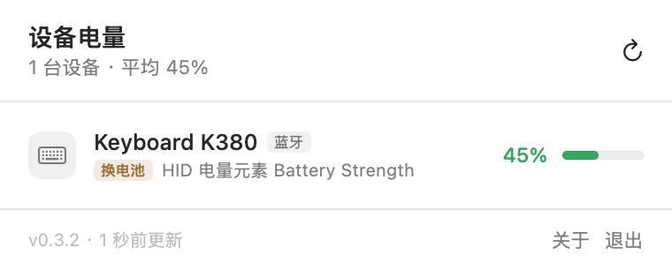
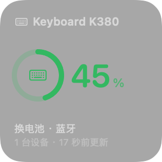
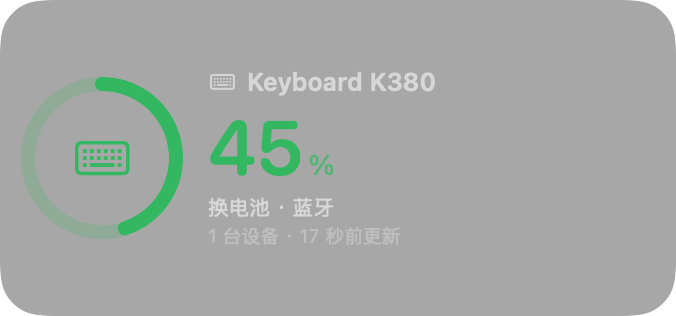
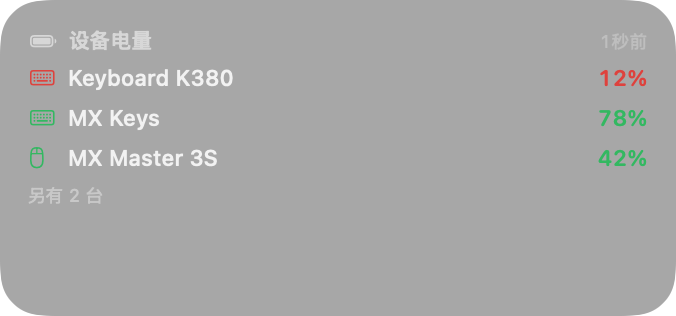
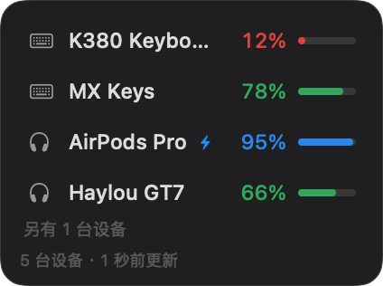

# PowerMeter · Mac 外设电量平台

[](https://github.com/polychromate/PowerMeter/releases)
[](https://github.com/polychromate/PowerMeter)
[](https://github.com/polychromate/PowerMeter-Plugins)

**版本 0.5.0** · 2026-11-01

菜单栏电量平台：优先复用 macOS 已经拿到的电量，读不到再用标准 HID / BLE 直读，
仍读不到就交给**独立安装的设备插件**处理厂商私有协议。新增设备通常只需要装一个插件，
不必更新 App。纯本地运行，不联网、不上传任何数据。

0.5.0 起支持 **WidgetKit 桌面小组件**：电量直接摆在桌面上，和时钟、提醒、天气排在一起。



> 0.3.2 及更早版本的说明已归档到 **[README-old.md](README-old.md)**。

---

## 一、平台要解决的三件事

| 问题 | 过去的做法 | 0.4.0 的做法 |
| --- | --- | --- |
| 系统已经有电量，没必要重复问设备 | 各自实现、重复读取 | 统一读取 macOS 已有电量（系统蓝牙 / IOBluetooth），成本最低 |
| 系统不报电量，但设备支持标准协议 | 散落在各个扫描器里 | 标准 HID Battery Strength、BLE `0x180F` 直读兜底 |
| 厂商私有协议，标准通道读不到 | 把驱动写进主程序，改代码 → 发新版 | 装一个 `.pmplugin` 插件，主程序不动 |

所以 PowerMeter 现在由两块组成：

- **平台**（本仓库）：设备发现、来源裁决、缓存、界面、插件运行时。
- **插件**（[PowerMeter-Plugins](https://github.com/polychromate/PowerMeter-Plugins)）：设备识别与协议解析。

---

## 二、下载与安装

### App

到 [Releases](https://github.com/polychromate/PowerMeter/releases) 下载 `PowerMeter-0.5.0.zip`，
解压后把 `PowerMeter.app` 拖进「应用程序」。

应用为自签名证书签名（`PowerMeter Dev`，无 Apple 开发者账号、未公证），
首次打开若提示「无法验证开发者」：

```bash
xattr -dr com.apple.quarantine /Applications/PowerMeter.app
```

### 设备插件

插件在独立仓库发布：[PowerMeter-Plugins Releases](https://github.com/polychromate/PowerMeter-Plugins/releases)。
下载 zip 后，在菜单面板点 **插件 › 安装插件…** 选择该 zip 即可。

不装插件也能用：系统电量、标准 HID / BLE 直读这两层是内置的，
AirPods、妙控系列、多数蓝牙键鼠、支持 BLE 电量服务的耳机都能直接读到。

---

## 三、三层电量来源

程序每 60 秒刷新一次：内置通道与所有插件并发执行，再按设备合并去重。

| 层级 | 通道 | 实现 | 典型设备 |
| --- | --- | --- | --- |
| ① 系统电量 | `system_profiler SPBluetoothDataType -json` | `Sources/BluetoothBattery.swift` | AirPods、Beats 等向 macOS 上报的设备 |
| ① 系统电量 | `IOBluetoothDevice.batteryPercent*` 私有属性 | `Sources/IOBluetoothBattery.swift` | 第三方耳机（系统设置里显示的那个数字） |
| ② 通用直读 | IOKit `BatteryPercent` 属性 | `Sources/HIDBattery.swift` | 苹果妙控系列 |
| ② 通用直读 | HID **Battery Strength** 元素 `GET_REPORT` | `Sources/HIDBattery.swift` | 多数蓝牙键鼠（K380、MX 系列…） |
| ② 通用直读 | BLE GATT `0x180F / 0x2A19` | `Sources/BLEScanner.swift` | 支持 BLE 电量上报的耳机、鼠标 |
| ③ 设备插件 | 厂商私有协议（HID++、私有 Input Report…） | `Sources/PluginPlatform.swift` | 罗技接收器、新盟 2.4G 接收器 |

BLE 扫描单独降频：**每 5 分钟一轮**，避免频繁连接打扰设备、增加耗电。
其余通道每分钟一轮。

### 来源裁决

同一台设备可能同时出现在多个通道里。裁决顺序（先有电量者优先，同级再比时间新鲜度）：

| 优先级 | 来源 | 说明 |
| --- | --- | --- |
| 0 | 插件（`preferPlugin` / `pluginOnly`） | 插件声明自己更准，覆盖系统结果 |
| 1 | 蓝牙上报（IOBluetooth） | 与系统设置面板同源 |
| 2 | 系统蓝牙（system_profiler） | Apple 设备常用 |
| 3 | HID 属性（BatteryPercent） | 系统已缓存 |
| 4 | HID 直读 / BLE 电池服务 | 主动查询，成本略高 |
| 5 | 插件（`fallback`） | 只有前面都读不到时才用 |

插件有三种来源策略，写在清单里，也可以按设备单独返回：

- `preferPlugin` — 插件优先，用于协议比系统更准的设备（罗技、新盟都用这个）。
- `fallback` — 系统与直读都失败后才启用，适合"锦上添花"的插件。
- `pluginOnly` — 只用插件，适合系统读数明显错误的设备。

另外两条规则：

- **缓存**：本次没读到电量时，沿用 15 分钟内的最后一次有效值，并标记为「可能已过期」。
- **未连接不算在线**：接收器插着、蓝牙已配对都不等于设备在线；判定离线的设备整行隐藏，
  原因写在「关于 › 运行状态」里。

---

## 四、插件平台

这是 0.4.0 的核心：让「支持一款新设备」从"改代码发版"变成"装一个插件"。

### 4.1 插件包结构

```text
com.example.device.pmplugin/          # 就是一个目录，扩展名 .pmplugin
├── manifest.json                     # 必需：身份、版本、兼容性、来源策略
├── plugin.js                         # 必需：设备识别 + 协议解析
└── ...                               # 可选：说明、测试样本等资源（当前运行时未开放文件读取）
```

发布时打包成 zip（例如 `com.example.device-1.0.0.pmplugin.zip`），
App 的安装器会解包并放到插件目录。

### 4.2 manifest.json

```json
{
  "id": "com.powermeter.logitech-hidpp",
  "name": "罗技 HID++",
  "version": "1.0.0",
  "apiVersion": 1,
  "minimumAppVersion": "0.4.0",
  "entry": "plugin.js",
  "author": "PowerMeter",
  "description": "通过 HID++ 2.0 读取罗技接收器与蓝牙直连设备的电量",
  "sourcePolicy": "preferPlugin"
}
```

| 字段 | 必填 | 说明 |
| --- | --- | --- |
| `id` | ✅ | 唯一标识，仅允许字母、数字、`.`、`-`；安装目录按它命名 |
| `name` | ✅ | 界面显示名 |
| `version` | ✅ | 插件自身版本 |
| `apiVersion` | ✅ | 必须与 App 的插件 API 版本一致（当前 `1`） |
| `minimumAppVersion` | ✅ | 语义化版本比较，低于它时拒绝加载 |
| `entry` | ✅ | 入口脚本；不允许绝对路径或 `..` |
| `sourcePolicy` | ✅ | `preferPlugin` / `fallback` / `pluginOnly` |
| `author` / `description` | — | 展示用 |

加载时校验：id 格式、API 版本、最低 App 版本、入口文件是否存在、来源策略是否合法。
任何一项不通过都会在「插件」面板里显示具体原因，而不是静默失败。

### 4.3 运行时与安全边界

每个插件跑在**自己的线程 + 自己的 JavaScriptCore 上下文**里：

- 刷新时平台调用插件的 `snapshot()`，最多等 12 秒，超时跳过本轮并记一条状态。
- 插件里没有 `require`、没有文件读写、没有网络、没有进程 API。
- 唯一的外部能力是一个受控 HID 桥 `hid`：枚举、打开、读 Report、写 Report、接收 Input Report。
- 插件拿到的原始报文由平台转成统一设备模型，界面不知道数据来自哪种协议。

这样做的好处：插件崩溃或死循环不会拖垮 App（线程隔离 + 超时），
同时插件也无法读你的文件或发网络请求。

### 4.4 插件 API

全局对象：`hid`、`powermeter`（`{ id, apiVersion }`）、`log(message)`。

| 调用 | 作用 |
| --- | --- |
| `hid.listDevices(match)` | 枚举 HID 设备，返回设备描述数组 |
| `hid.openDevice(id)` | 独占打开设备（罗技接收器等需要独占） |
| `hid.closeDevice(id)` | 关闭设备 |
| `hid.setReport({ id, type, reportID, data })` | 写 Report，`type` 为 `output` / `feature` / `input` |
| `hid.getReport({ id, type, reportID, length })` | 读 Report，返回字节数组 |
| `hid.takeReports(id)` | 取走并清空缓存的 Input Report（适合常驻监听） |
| `hid.wait(ms)` | 等待并驱动 RunLoop，用于协议往返（1–1000 ms） |
| `hid.status()` | 最近一次错误（权限、IOKit 返回码、设备断开） |
| `hid.requestAccess()` | 主动请求「输入监控」权限 |

`match` 支持的键：`vendorID`、`productID`、`usagePage`、`usage`、`transport`、`productContains`
（整数按 HID 属性精确匹配，`productContains` 为不区分大小写的子串匹配）。

设备描述字段：`id`、`product`、`manufacturer`、`vendorID`、`productID`、
`usagePage`、`usage`、`transport`、`locationID`。

### 4.5 插件必须实现什么

**`snapshot()`（必需）** 返回一次完整读数：

```js
{
  devices: [
    {
      id: "receiver-1-mxkeys",   // 插件内唯一
      name: "MX Keys",           // 与系统来源同名时会被合并
      kind: "keyboard",          // keyboard / mouse / headset / trackpad / gamepad / speaker / microphone / other
      transport: "logitechReceiver", // logitechReceiver / bluetooth / ble / usb / hid
      level: 45,                 // 0–100，读不到就给 null
      charging: false,
      connected: true,           // false 会被整行隐藏
      detail: "接收器直读 · 充电中", // 悬浮提示里的说明
      lastUpdate: Date.now(),    // 毫秒时间戳
      stale: false,              // true 表示这是旧值
      extra: { "电压": "3980 mV" }, // 悬浮提示里的附加字段
      sourcePolicy: "preferPlugin"  // 可覆盖清单里的策略
    }
  ],
  status: ""                     // 可选：出错原因，会显示在「关于 › 运行状态」
}
```

**`selfTest()`（可选）** 返回错误字符串数组，供 `--plugin-self-test` 做无硬件回归：

```js
function selfTest() {
  var errors = [];
  if (parseReport([0x13, 0, 0, 0, 0, 0, 0x63, 0x00]).level !== 99) errors.push("在线报文");
  return errors;
}
```

### 4.6 安装、升级与卸载

| 操作 | 方式 |
| --- | --- |
| 安装 / 升级 | 面板 **插件 › 安装插件…**，选 `.pmplugin` 目录或 zip；同 id 覆盖安装即升级 |
| 重新载入 | 面板 **插件 › 重新载入**，改完插件不用重启 App |
| 打开目录 | 面板 **插件 › 插件目录** |
| 卸载 | 在插件目录里删掉对应的 `<id>.pmplugin`，再点「重新载入」 |
| 命令行安装 | `PowerMeter --install-plugin <路径>` |

安装位置：`~/Library/Application Support/PowerMeter/Plugins/`。
开发时可用环境变量 `POWERMETER_PLUGIN_DIR` 指向源码目录，直接对着工作副本调试。

插件与 App 的版本关系是松耦合的：插件升级不需要重装 App；
只有当插件要求更高的 `apiVersion` / `minimumAppVersion` 时，才需要升级主程序。

### 4.7 插件索引

插件仓库构建时会生成 `index.json`，列出每个插件的 id、版本、兼容性、下载地址和 SHA-256。
它是**给分发用的清单**：目前 App 还没有内置插件商店，需要手动下载 zip 安装；
后续版本会接入这个索引，实现应用内浏览与一键更新。

---

## 五、写一个插件

下面是一个最小可用插件：一台走标准 HID Battery Strength 的蓝牙键盘（示意值，请按实际报文调整）。

`manifest.json`：

```json
{
  "id": "com.example.simple-hid",
  "name": "示例：标准 HID 电量",
  "version": "1.0.0",
  "apiVersion": 1,
  "minimumAppVersion": "0.4.0",
  "entry": "plugin.js",
  "sourcePolicy": "fallback"
}
```

`plugin.js`：

```js
var handle = null;

function ensureDevice() {
  if (handle) return "";
  // 先按 VID/PID 找，找不到再放宽到 usagePage
  var devices = hid.listDevices({ usagePage: 0x0001, productContains: "Example Keyboard" });
  if (!devices.length) return hid.status();          // 空字符串表示"没发现设备"，不是错误
  if (!hid.openDevice(devices[0].id)) return hid.status() || "无法打开设备";
  handle = devices[0].id;
  return "";
}

function readLevel() {
  // 标准 Battery Strength：report ID 3，第二个字节是 0–20 的逻辑量
  var report = hid.getReport({ id: handle, type: "input", reportID: 3, length: 8 });
  if (!report.length) return null;
  return Math.round((report[1] & 0x1f) * 100 / 20);
}

function snapshot() {
  var error = ensureDevice();
  if (!handle) return { devices: [], status: error };

  var level = readLevel();
  return {
    devices: [{
      id: "example-keyboard",
      name: "Example Keyboard",
      kind: "keyboard",
      transport: "bluetooth",
      level: level,
      charging: false,
      connected: true,
      detail: level === null ? "已连接，本次未读到电量（设备休眠）" : "HID Battery Strength",
      lastUpdate: Date.now(),
      stale: false,
      extra: { "协议": "HID 0x0006/0x0020" }
    }],
    status: error
  };
}

function selfTest() {
  return [];   // 纯解析逻辑可以在这里做断言
}
```

调试建议：

```bash
# 1. 直接对着源码目录跑，改完在面板点「重新载入」
POWERMETER_PLUGIN_DIR=/path/to/myplugin \
  /Applications/PowerMeter.app/Contents/MacOS/PowerMeter --plugin-self-test

# 2. 看某台设备为什么没电、各通道抓到了什么
/Applications/PowerMeter.app/Contents/MacOS/PowerMeter --dump
```

几条经验：

- `snapshot()` 每次刷新都会被调用，**不要在里面做耗时握手**；把会话缓存在闭包里。
- 常驻上报的设备（如接收器）用 `hid.takeReports()` 排空缓存，别用 `getReport` 硬等。
- 设备休眠是常态：读不到就返回 `level: null`，平台会沿用 15 分钟内的旧值并标注过期。
- 设备真的离线时返回 `connected: false`，界面会整行隐藏，不会拿 0% 吓人。

---

## 六、现有插件

| 插件 | 支持的设备 | 读取方式 | 版本 |
| --- | --- | --- | --- |
| **罗技 HID++** `com.powermeter.logitech-hidpp` | Unifying / Bolt 接收器下的罗技键鼠、蓝牙直连罗技外设 | HID++ 2.0：`0x1000` → `0x1004` → `0x1001`（电压换算），自动探测 1–6 号槽位 | 1.0.0 |
| **新盟 2.4G** `com.powermeter.xinmeng` | 新盟 A99 / M71 等 2.4G 接收器键盘（VID `0x3554`） | 监听 vendor Input Report `0x13`，过滤键盘离线占位报文 | 1.0.0 |

源码、构建脚本、插件索引在 [polychromate/PowerMeter-Plugins](https://github.com/polychromate/PowerMeter-Plugins)，
可以单独 clone、单独发版。

---

## 七、界面与显示规则

- 启动后没有 Dock 图标，只在菜单栏出现电量图标；点击展开面板，右上角可手动刷新。
- 每 60 秒自动刷新。
- 鼠标悬停任意一行，可看到数据来源、协议细节、电池类型判定依据。
- 每台设备带电池类型标签：`锂电池`（内置可充电）或 `换电池`（AA/AAA），判断不出就不显示。

**菜单栏只显示一台设备的电量**，挑选顺序：

1. 未充电的锂电池设备中电量最低的一台（最需要关注）；
2. 若锂电池设备都在充电 → 显示充电中的锂电池设备；
3. 若没有锂电池设备 → 显示其它有读数的设备。

可更换电池的设备不抢菜单栏位置。未充电的锂电池设备电量 < 15% 时，菜单栏数字变红、
面板顶部出现红色提醒条；充电中的设备不触发（充电时的 0% 不是异常）。

电池类型判定顺序（`Sources/BatteryClassifier.swift`）：手动指定 → 观察到充电 →
罗技电压读数 → 已知型号库 → 类型兜底。型号不在库里时可以自己写
`~/Library/Application Support/PowerMeter/battery-types.json`：

```json
{ "m720": "replaceable", "mx keys": "lithium" }
```

键按小写子串匹配设备名，重启 App 生效。

### 桌面小组件

0.5.0 新增。PowerMeter 提供 WidgetKit 桌面小组件，和时钟、提醒、天气放在同一套桌面网格里。

  

添加方式：**在桌面空白处右键 →「编辑小组件」→ 搜索 PowerMeter → 选尺寸拖到桌面**。

| 尺寸 | 显示内容 |
| --- | --- |
| 小 | 一台主设备：环形电量 + 大号百分比 + 电池类型 |
| 中 | 单设备时横向铺开；多设备时三行列表 |
| 大 | 最多七台设备的列表 |

数据流向：主程序每 60 秒扫一次，把结果写进共享的 `widget.json`；小组件只读这个文件，
不自己碰蓝牙和 HID。所以**主程序得在跑**（菜单栏图标还在），否则小组件显示的是最后一次写入的数据。

小组件的时间线每 90 秒问一次，系统会自行节流，实际刷新可能滞后几分钟——
这是 WidgetKit 的规矩，不是程序偷懒。

维护者注意三点：

- 扩展 `com.chenge.PowerMeter.Widget` 装在 `PowerMeter.app/Contents/PlugIns/PowerMeterWidget.appex`，
  带 `com.apple.security.app-sandbox`。**没有用 App Group**：自签名证书拿不到 App Group 容器，
  所以改成主程序（无沙盒）把数据写进扩展自己的容器目录，扩展读自己的地盘不需要额外授权。
- 签名**不能**对主程序用 `--deep`，它会把同一套参数套到嵌套代码上，抹掉扩展的 entitlement，
  结果是扩展注册成功但加载失败。`build.sh` 里是先签 appex 再签主体。
- **必须链接 `_NSExtensionMain` 作为入口点**（`swiftc` 加 `-Xlinker -e -Xlinker _NSExtensionMain`）。
  手工编译的可执行文件默认入口是 Swift 的 `main`，于是 WidgetKit 的 `@main` 会落进 ExtensionFoundation，
  它认不出这是小组件扩展，进程在回答 `getAllDescriptors` 之前就退出——现象是扩展注册得好好的、
  面板里却一个都搜不到，而且不报错。判断方法：`nm -u 二进制 | grep NSExtensionMain` 必须有输出。
  另外 appex 的 `CFBundleVersion` 每次构建要变，系统按它缓存小组件描述符，版本不变就一直用旧缓存。

### 桌面贴片（可选，默认关闭）

0.4.x 开发过程中做的自绘浮窗：不受系统网格限制，位置、尺寸、样式完全自己说了算，
缺点是不进系统「编辑小组件」面板。0.5.0 起默认关闭，可在面板底部「磁贴」里打开。

 

- 尺寸 176 / 212 / 252 三档，外观毛玻璃 / 浅色 / 深色，层级「贴在桌面」或「始终置顶」。
- 拖动移动、靠近屏幕边缘 20pt 自动吸附；位置按屏幕相对比例记忆，换分辨率后仍在原处。
- 右键改设置，双击打开菜单栏面板。

---

## 八、命令与诊断

```bash
APP=/Applications/PowerMeter.app/Contents/MacOS/PowerMeter

$APP --dump                  # 打印各通道原始抓取结果，排查设备为什么读不到
$APP --snapshot out.png      # 离屏渲染界面截图（不需要屏幕录制权限）
$APP --snapshot-tile t.png   # 离屏渲染桌面磁贴，多设备图 + t-single.png 单设备图
$APP --install-plugin <路径>  # 安装 / 升级插件
$APP --plugin-self-test      # 跑所有插件的 selfTest()，无硬件也能验解析逻辑
```

运行时的最近一次结果会写到 `~/Library/Application Support/PowerMeter/last-scan.json`，
含设备、来源、插件版本、菜单栏选择和状态提示。

---

## 九、权限

| 权限 | 什么时候需要 | 说明 |
| --- | --- | --- |
| 蓝牙 | 首次启动 | BLE 电量服务扫描、耳机连接状态 |
| 输入监控 | 插件需要打开 HID 设备时（如新盟接收器键盘） | macOS 对 GUI App 打开 HID 强制要求，且不会自动弹窗 |

不装需要 HID 独占的插件，就不需要「输入监控」。
没授权时 App 会调用 `IOHIDRequestAccess` 触发弹窗，被拒后请到
`系统设置 › 隐私与安全性 › 输入监控` 手动启用并重启 App；
插件面板会直接显示这条原因，不会静默失败。

---

## 十、从源码构建

```bash
git clone https://github.com/polychromate/PowerMeter.git
cd PowerMeter
./build.sh              # 编译，产物在 build/PowerMeter.app
open build/PowerMeter.app
```

需要 Xcode Command Line Tools（`xcode-select --install`），不依赖完整 Xcode。
装到「应用程序」：

```bash
cp -R build/PowerMeter.app /Applications/
```

`./release.sh` 会额外产出 `releases/PowerMeter-<版本>.zip`（可直接运行）和
`PowerMeter-<版本>-source.zip`（该版本源码）。

---

## 十一、实测结果（本机 macOS 26.6.2）

| 设备 | 连接方式 | 读数 | 通道 |
| --- | --- | --- | --- |
| Logitech MX Keys | Unifying 接收器 | ✅ 可读 + ⚡充电状态（实测 0%，充电中） | 插件 罗技 HID++ |
| Logitech M720 Triathlon | Unifying 接收器 | ✅ 可读（实测 50%） | 插件 罗技 HID++ |
| 新盟 A99 键盘 | 2.4G 接收器（`0x3554:FA09`） | ✅ 可读（实测 1%→100%，充电状态准确） | 插件 新盟 2.4G |
| HAYLOU S35 ANC | 经典蓝牙（HFP/A2DP） | ✅ 可读（实测 90%，与系统设置一致） | 蓝牙上报 |
| Robin's Earphones | 经典蓝牙（HFP） | ✅ 可读（实测 50–60%） | 蓝牙上报 |
| DJI Mic Mini | 经典蓝牙（HFP） | ✅ 可读（实测 50–60%，偶发单轮 0 读数下一轮恢复） | 蓝牙上报 |
| Logitech K380 | 经典蓝牙（HID） | ✅ 可读（实测 45%） | HID Battery Strength |
| 英菲克 IN9 鼠标 | 2.4G 接收器（`0x248A:5B2F`） | ❌ 接收器不暴露任何电量通道，切蓝牙模式可试 | — |

---

## 十二、文件结构

```
PowerMeter/
├── build.sh                  # 一键编译（swiftc，无需 Xcode）
├── release.sh                # 编译 + 打包 app / 源码到 releases/
├── Info.plist                # LSUIElement 菜单栏应用 + 蓝牙用途说明 + 版本号
├── Sources/
│   ├── main.swift            # 入口：--dump / --snapshot / --snapshot-tile / --install-plugin / --plugin-self-test
│   ├── AppDelegate.swift     # 状态栏图标、菜单栏选机策略、弹窗、单实例保护
│   ├── Models.swift          # 统一设备模型、来源枚举、电池类型
│   ├── DeviceStore.swift     # 多源聚合、来源裁决、缓存、菜单栏候选
│   ├── PluginPlatform.swift  # 清单校验、安装、JS 运行时、超时与状态
│   ├── PluginHIDBridge.swift # 插件可见的受控 HID API
│   ├── BluetoothBattery.swift    # 系统蓝牙
│   ├── IOBluetoothBattery.swift  # 蓝牙上报（同系统设置）
│   ├── HIDBattery.swift          # HID 属性 + Battery Strength 直读
│   ├── BLEScanner.swift          # BLE 电池服务 0x180F
│   ├── BatteryClassifier.swift   # 锂电池 / 换电池判定
│   ├── ContentView.swift         # SwiftUI 界面与插件管理面板
│   ├── DesktopTile.swift         # 可选桌面贴片：窗口层级、拖动吸附、偏好、视图与设置
│   ├── WidgetBridge.swift        # 把电量写进小组件容器（跨进程数据桥）
│   └── SnapshotMode.swift        # ImageRenderer 离屏截图（面板 + 贴片）
├── Widget/                   # 桌面小组件扩展（单独编译成 appex）
│   ├── PowerMeterWidget.swift    # Widget 声明与 TimelineProvider
│   ├── WidgetViews.swift         # 小 / 中 / 大三种尺寸的视图
│   ├── WidgetModel.swift         # 共享数据读取与展示辅助
│   ├── Info.plist                # widgetkit-extension 声明
│   └── PowerMeterWidget.entitlements  # 沙盒权限
├── Resources/                # 图标与截图
└── releases/                 # 各版本产物（不进 git）
```

---

## 十三、当前边界

明确写出来，避免期待落空：

- **插件目前只能访问 HID**。BLE GATT 读写还没有开放给插件，BLE 设备走内置扫描器；
  需要 GATT 私有协议的设备暂时只能等平台补上这层能力。
- **没有签名校验**。插件安装时不做代码签名或公证检查，请只安装可信来源的插件。
- **没有应用内插件商店**。`index.json` 已随插件仓库发布，但 App 还没消费它，
  目前需要手动下载 zip。
- **插件是用户态实现**，不加载原生动态库、不装内核扩展；需要复杂原生能力的协议
  目前只能靠 JavaScript 在 HID 报文层面实现。
- 设备身份仍以**规范化设备名**为合并键。同名设备（两台完全一样的键盘）可能被合并。
- 只允许运行一个实例（HID 设备通常独占，多开会导致读不到电量）。
- **小组件要靠主程序供数据**。主程序退出后，桌面小组件停留在最后一次读到的电量，
  不会自己扫描——它没有蓝牙 / HID 权限，也不该有。
- **小组件刷新受系统节流**，没有「每秒刷新」这种选项；主程序面板里的数字才是实时的。
- 可选的自绘贴片跟随菜单栏常在，没有「仅在某桌面空间显示」的设置，开着就在所有空间可见。

---

## 十四、版本历史

### 0.5.0 — 2026-11-01

- 新增 **WidgetKit 桌面小组件**：电量直接显示在桌面上，和时钟、提醒、天气排在同一套网格里。
  - 三种尺寸：小 = 单设备环形电量；中 = 单设备横向版 / 三行列表；大 = 最多七台列表。
  - 自签名也能用：扩展带沙盒 entitlement，主程序把数据写进扩展容器，绕开 App Group 限制。
  - 新增 `Sources/WidgetBridge.swift` 负责跨进程投递数据，小组件时间线每 90 秒取一次（系统会节流）。
- 新增可选的自绘**桌面贴片**（默认关闭）：不依赖系统小组件，位置样式更自由，
  支持三档尺寸、三种外观、拖动吸附与位置记忆，右键改设置。可在面板底部「磁贴」打开。
- 新增 `--snapshot-tile` 命令，可离屏渲染自绘贴片。
- `DeviceKind` 的图标映射抽成 `symbolName`，面板、贴片与小组件共用同一套。

### 0.4.1 — 2026-11-01

- 「关于」面板移除固定的「数据来源」清单：原来写死了系统蓝牙 / HID / BLE / 插件等条目，
  还举例「罗技、新盟」等厂商，对没装这些插件的人没有意义。
  面板现在只保留电池类型说明、「运行状态」（动态显示插件与权限问题）和读取能力提示。
- 插件相关状态仍在「运行状态」与「插件」面板中查看，信息没有丢失。

### 0.4.0 — 2026-11-01

- 从「支持若干设备的小工具」改造为**电量平台**：系统电量优先、标准 HID/BLE 直读兜底、
  设备插件按策略覆盖。
- 新增独立插件机制（API v1）：清单与版本兼容校验、zip 安装、独立线程 JavaScriptCore 运行时、
  受控 HID 桥、三种来源策略、12 秒超时保护、插件管理面板与命令行安装/自测。
- 罗技 HID++ 与新盟 2.4G 从主程序源码**完全移出**，迁移为两个独立插件，
  发布在 [PowerMeter-Plugins](https://github.com/polychromate/PowerMeter-Plugins)。
- 拆分 HID `BatteryPercent` 系统属性与 `Battery Strength` 主动直读的来源标记，
  使「系统优先、直读兜底」可以被正确裁决。
- 新增 `last-scan.json` 中的插件与来源信息，便于排查。
- 主程序仍保持本地运行、不联网。

更早版本（0.1.0 – 0.3.2）的完整记录见 **[README-old.md](README-old.md)**。
