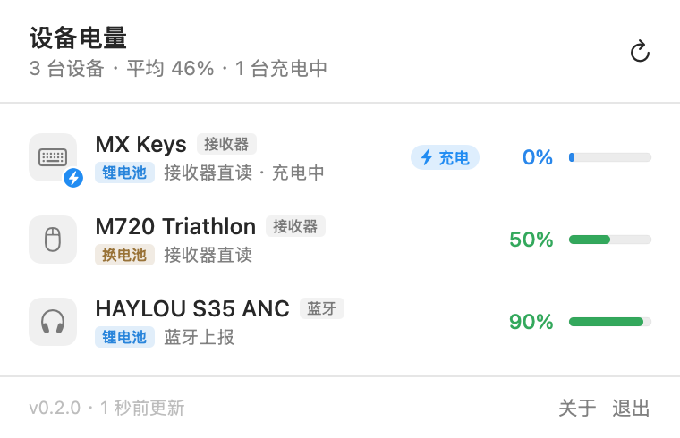

# PowerMeter · Mac 外设电量监视器

**版本 0.2.0** · 2026-10-25

菜单栏小工具，实时显示罗技键鼠、蓝牙耳机的电量。本地运行，不联网、不上传任何数据。



## 当前实测结果（本机 macOS 26.6.2）

| 设备 | 连接方式 | 读数 | 读取通道 |
| --- | --- | --- | --- |
| Logitech MX Keys | Unifying USB 接收器 | ✅ 可读 + ⚡充电状态（实测 0%，充电中） | HID++ 2.0 `0x1000` |
| Logitech M720 Triathlon | Unifying USB 接收器 | ✅ 可读（实测 50%） | HID++ 2.0 `0x1000` |
| HAYLOU S35 ANC | 经典蓝牙（HFP/A2DP） | ✅ 可读（实测 90%，与系统设置一致） | IOBluetooth `batteryPercentSingle` |

> 悬浮任意一行可看到原始通道信息，例如 `HID++ 0x1000 · 充电中`。

## 运行

```bash
cd PowerMeter
./build.sh              # 编译，产物在 build/PowerMeter.app
open build/PowerMeter.app
```

装到「应用程序」以便长期使用：

```bash
cp -R build/PowerMeter.app /Applications/
```

启动后没有 Dock 图标，只在菜单栏出现电量图标（显示当前最需要关注的那台设备的电量）。点击图标展开面板。

- 每 60 秒自动刷新，点击面板右上角可手动刷新
- 鼠标悬停某一行可看到电池类型判定依据、数据来源、协议细节
- 每台设备带电池类型标签：`锂电池`（内置可充电）或 `换电池`（AA/AAA）
- 菜单栏优先显示**未充电的锂电池设备**的电量，可更换电池设备不抢位置
- 未充电的锂电池设备电量 < 15% 时，菜单栏数字变红，面板顶部出现红色提醒条
- 正在充电的设备显示蓝色电量条 + 「⚡充电」标签，图标右下角带闪电徽标

## 电池类型标签

| 标签 | 含义 | 电量低时该做什么 |
| --- | --- | --- |
| `锂电池` | 内置可充电锂电（MX Keys、HAYLOU、妙控系列…） | 插线充电 |
| `换电池` | 使用 AA / AAA 电池（M720 Triathlon、K380、M185…） | 换一节新电池 |
| 无标签 | 判断不出来（型号不在已知库，也没观察到充电） | — |

判定顺序（`Sources/BatteryClassifier.swift`，可靠性从高到低）：

1. `~/Library/Application Support/PowerMeter/battery-types.json` 手动指定；
2. 观察到充电状态 → 锂电池（只有可充电电池才会报 charging）；
3. 罗技 `0x1001` 电压读数 → ≤3.3V 判为 AA/AAA，≥3.4V 判为单节锂电；
4. 已知型号库（MX Keys / MX Master / 妙控系列 / AirPods / M720 / K380 …）；
5. 类型兜底：耳机、触控板基本都是内置锂电。

判断不出来就不显示标签 —— 宁可不说，也不给错信息。型号不在库里时可以自己指定：

```json
{ "m720": "replaceable", "mx keys": "lithium" }
```

写到 `~/Library/Application Support/PowerMeter/battery-types.json` 即可，键按小写子串匹配设备名（重启 App 生效）。

## 菜单栏显示规则

菜单栏只显示**一台**设备的电量，按下面的优先级挑选：

1. 未充电的锂电池设备中电量最低的一台（最需要关注）；
2. 若锂电池设备都在充电 → 显示充电中的锂电池设备；
3. 若没有锂电池设备 → 显示其它有读数的设备。

可更换电池的设备**不会抢占**菜单栏位置：AA 电池没电换一节就好，不需要你惦记。
鼠标悬停菜单栏图标可以看到当前显示的是哪台设备、以及为什么选它。

低电量提醒：未充电的**锂电池**设备电量 < 15% 时，菜单栏数字变红、面板顶部出现红色提醒条。
正在充电的设备不触发提醒（充电中的 0% 不是异常）；可更换电池设备也不触发（换电池即可）。

## 权限

首次启动会请求「蓝牙」权限（`系统设置 › 隐私与安全性 › 蓝牙`），用于 BLE 电池服务扫描和耳机连接状态。
HID++ 读取罗技接收器不需要额外授权。

## 五路数据来源

程序按精度从高到低聚合五类通道，同一设备自动合并去重：

1. **罗技 HID++ 2.0**（`Sources/LogitechHIDPP.swift`）
   直接与 Unifying / Bolt 接收器或蓝牙直连的罗技外设对话，按 `getFeature` 解析
   `0x1000 BATTERY_LEVEL_STATUS` → `0x1004 UNIFIED_BATTERY` → `0x1001 BATTERY_VOLTAGE`（电压换算）。
   `0x1000` 的第三个参数字节是充电状态枚举（0 放电 / 1 充电 / 2 即将充满 / 3 已充满 / 4 慢充），
   界面据此显示「⚡充电」徽标；`0x1004` 按 v4 规范先用 fn0 读能力、再用 fn1 读电量。
   接收器会自动探测 1–6 号配对槽位；设备休眠时沿用最近一次读数并标注。
2. **系统蓝牙**（`Sources/BluetoothBattery.swift`）
   解析 `system_profiler SPBluetoothDataType -json` 的已连接设备，可读 AirPods / Beats 等
   向 macOS 上报电量的设备（含左右耳、充电盒）。
3. **HID 属性**（`Sources/HIDBattery.swift`）
   枚举 IOHID 设备的 `BatteryPercent`，覆盖苹果妙控系列与部分第三方 HID 设备。
4. **蓝牙上报**（`Sources/IOBluetoothBattery.swift`）
   读取 `IOBluetoothDevice` 的私有属性 `batteryPercentSingle` / `batteryPercentLeft` /
   `batteryPercentRight` / `batteryPercentCase`。**这正是 macOS「系统设置 → 蓝牙」里
   第三方便携耳机电量的来源**，`system_profiler` 并不导出这些值。
5. **BLE 电池服务**（`Sources/BLEScanner.swift`）
   扫描 GATT `0x180F` 服务并读取 `0x2A19`，覆盖支持 BLE 电量上报的耳机与鼠标。

## 关于耳机（HAYLOU S35 ANC）

一开始结论是「读不到」，后来定位到真正的通道，现已正常显示：

- `system_profiler SPBluetoothDataType` 与 IORegistry 里确实**没有** `device_batteryLevel*`
  —— 这条路只对 AirPods 等 Apple 设备有效，容易让人误判为「耳机不上报」；
- CoreBluetooth 也扫不到它（经典蓝牙连接时不开放 BLE 广播），没有 `0x180F` 电池服务；
- 真正的数据在 `IOBluetoothDevice` 的私有属性 `batteryPercentSingle` 上：bluetoothd 收到耳机
  HFP `AT+IPHONEACCEV` 后写入该属性，系统设置面板读的就是它。

因此 App 增加了一路 IOBluetooth 数据源，现在与系统设置显示的数值一致（实测 90%）。
工程上有个坑：`+[IOBluetoothDevice pairedDevices]` **不能在主线程调用**
（内部会等主队列信号量，直接死锁/崩溃），必须在后台线程；而且它只能在
LaunchServices 启动的 App 里调用，终端里直接执行二进制会因 TCC 无法归属而被内核中止，
所以 `--dump` 会跳过这一路并给出提示。

## 命令行诊断

```bash
# 打印各数据源的原始抓取结果，排查某台设备为什么没有电量
build/PowerMeter.app/Contents/MacOS/PowerMeter --dump

# 离屏渲染界面截图（不需要屏幕录制权限）
build/PowerMeter.app/Contents/MacOS/PowerMeter --snapshot out.png
```

运行时的最近一次扫描结果也会写到
`~/Library/Application Support/PowerMeter/last-scan.json`，便于排查。

## 文件结构

```
PowerMeter/
├── build.sh                  # 一键编译（swiftc，无需 Xcode）
├── release.sh                # 编译 + 打包 app / 源码到 releases/
├── Info.plist                # LSUIElement 菜单栏应用 + 蓝牙用途说明 + 版本号
├── Sources/
│   ├── main.swift            # 入口，含 --dump / --snapshot 分支
│   ├── AppDelegate.swift     # 状态栏图标、菜单栏选机策略、弹窗、单实例保护
│   ├── Models.swift          # 设备模型、电池类型枚举、低电量阈值
│   ├── BatteryClassifier.swift  # 锂电池 / 换电池判定
│   ├── LogitechHIDPP.swift   # HID++ 协议实现 + 后台线程会话
│   ├── BluetoothBattery.swift
│   ├── IOBluetoothBattery.swift # 第三方耳机电量（等同系统设置）
│   ├── HIDBattery.swift
│   ├── BLEScanner.swift
│   ├── DeviceStore.swift     # 多源聚合、去重、缓存、菜单栏候选
│   ├── ContentView.swift     # SwiftUI 界面
│   └── SnapshotMode.swift    # ImageRenderer 离屏截图
├── Resources/                # 图标与截图
└── releases/                 # 各版本的 app 包与源码包（不进 git）
```

## 说明

- 只允许运行一个实例（罗技接收器是独占设备，多开会导致读不到电量）
- 编译使用系统自带 `swiftc`，产物为 arm64、ad-hoc 签名；不需要安装 Xcode
- 设备休眠时读不到新值，会显示上一次的有效读数（电量条半透明）并在提示中说明

## 版本与归档

仓库用 git 打标签保存每个可用版本：

```bash
git tag -l                     # v0.1.0  v0.2.0
git checkout v0.1.0            # 回到 0.1.0 的完整工程（含当时的 README）
./release.sh                   # 当前版本编译 + 打包到 releases/
```

`releases/` 下每个版本有两个包：`PowerMeter-<版本>.zip`（可直接运行的 app）
和 `PowerMeter-<版本>-source.zip`（该版本 tag 的完整源码，含 README）。

## 版本历史

### 0.2.0 — 2026-10-25

- 新增电池类型标签：`锂电池`（内置可充电）/ `换电池`（AA、AAA），依据型号库、充电状态、电压区间综合判定，判断不出就不打标签
- 菜单栏改为「优先显示未充电的锂电池设备」，可更换电池设备不再抢占菜单栏位置
- 未充电的锂电池设备电量 < 15% 时，菜单栏数字变红 + 面板顶部红色提醒条
- 支持 `~/Library/Application Support/PowerMeter/battery-types.json` 手动指定电池类型
- 运行时快照新增 `menuBar` 段，便于确认菜单栏当前选了哪台设备

### 0.1.0 — 2026-10-25

首个可用版本，本机实测通过（MX Keys / M720 Triathlon / HAYLOU S35 ANC 三台设备全部正确读数）。

- 五路数据源聚合：罗技 HID++ 2.0、系统蓝牙、HID `BatteryPercent`、IOBluetooth 私有电量、BLE `0x180F`
- 罗技充电状态解析（`0x1000` 状态枚举），界面显示闪电徽标 + 「⚡充电」标签
- 第三方耳机电量（IOBluetooth `batteryPercentSingle`），与系统设置一致
- 设备休眠时沿用最近一次读数并半透明标注
- `--dump` 数据源诊断、`--snapshot` 离屏渲染截图
